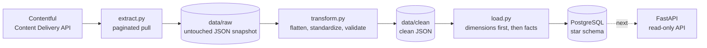

# Memphis Events Pipeline: From a Newsletter CMS to a Queryable Warehouse

> **Draft status:** Everything below comes from work done so far (extract, transform, schema, SQL, loader). Numbers marked as measured were checked against the data files. Items marked **[TODO]** need results or words only you have: the database load results and your own voice in "How I worked" and "What I learned". The API layer is not built yet, so this draft stops at the loaded warehouse.

## Summary

I turned about 15 months of Memphis tech event listings (September 2025 through December 2026, including upcoming events), stored in a publishing CMS, into a clean, queryable PostgreSQL warehouse. A Python pipeline pulls the events from Contentful, cleans inconsistent values, and loads them into a star schema. The loader is designed so that re-running it never creates duplicates. The next layer is a small read-only FastAPI service on top.

**Stack:** Python (requests, pandas, psycopg2), Contentful Content Delivery API, PostgreSQL, SQL (star schema).

## The problem

The Memphis Tech Scene newsletter publishes community events every week. Those events live in Contentful, a CMS built for publishing content, not for analysis. That created three problems:

- **No way to ask questions of the data.** Contentful has no query layer for questions like "how many events per month?" or "which categories dominate?"
- **Nothing enforced consistency.** Fields were free text, so the same value was typed several ways.
- **Awkward shape.** The API returns nested JSON with linked entries, not rows and columns.

**Goal:** make the event history queryable, trustworthy, and ready to serve through an API.

## Architecture

Each stage has one job and writes its output to disk, so any stage can be re-run without repeating the ones before it.

## Key decisions and trade-offs

| Decision | Why | Trade-off |
|---|---|---|
| Paginated extract, not a single request | A single request silently misses entries past the page limit | More code, but correct |
| Keep the raw snapshot untouched | Cleaning can be re-run without hitting the API again, and raw data is never lost | Extra files on disk |
| Separate extract, transform, and load scripts | Each can be tested and re-run on its own | More files to manage |
| Fail loudly on 4xx errors, retry only on 429 and 5xx | Bad credentials should stop the run, not be retried | Needs manual fixes when credentials break |
| Standardize with a lookup table, not hand-fixes | Handles spelling variants I haven't seen yet | Unknown values are flagged, not guessed |
| Star schema with one fact table and four dimensions | Built for the questions I want to ask (counts by month, category, group, time of day) | More joins than one flat table |
| Upsert on the Contentful event ID | Re-running the pipeline can't create duplicates | Needs a separate rule for removed events |
| Flag removed events (`is_active = false`) instead of deleting them | Keeps history and is reversible if an event comes back | One extra column; queries must filter on it. The loader refuses to run if the snapshot is under half the size of the warehouse, so a failed extract can't deactivate everything |
| Date and time stored as a `DATE` plus a nullable `TIME` | Matches the source (a date and a wall-clock time, no time zone). All events are in Memphis (America/Chicago), and a missing time stays NULL instead of an invented value. A single timestamp would force a fake time, and a timestamp with time zone would add DST conversion and shift day boundaries (a 7 PM Central event falls on the next day in UTC) | Two columns to combine when an exact instant is needed |
| Events with no group use the source's own "Random Group" row, flagged `is_catch_all` | The source already uses it as the bucket for events with no group, so there is nothing to invent. The flag keeps it out of group rankings without a hard-coded ID in every query | The catch-all must be excluded from group questions |
| Registration links not stored | The source field is a URL (or `TBD`), an address and not a countable measure. Nothing in the questions needs it | The API can't link out to registration pages |
| Event details (name, description, intro) on the fact table | One row per event, so a separate event dimension would add a join and a second key for no analytical gain | A wider fact table than textbook |
| Compute month, weekday and hour in queries | They can be derived from the date and time, and stored copies could drift. Only the `dim_date` key is stored | Slightly longer queries |

## What the data looked like

I audited the entries by counting the exact string values per field before writing any cleaning rules. The first audit covered 435 entries (the 2026-10-29 snapshot); the latest snapshot has 440. All counts in this section were re-checked against the files.

- **Event type (attendance format):** 6 distinct values where there should be 3. "In Person" (36 rows), "INPERSON" (1), and "VIRTUAL" (1) were variants of "In-Person" and "Virtual". **38 of 435 rows (about 9%)** needed fixing.
- **Event category:** 9 distinct values where there should be 7. "WORKSHOP" and "Tech TalkNetworking" (two categories run together) were the errors. I mapped the second to "Tech Talk", which is a judgment call I documented. 2 rows needed fixing.
- **Time:** 41 distinct values in mixed formats: `18:00`, `9:15`, `0900`, `1730`, and `4PM`/`11AM`. I normalized them to 24-hour `HH:MM`. **17 rows changed** and every value parsed, leaving 30 distinct values in the latest clean file. One value, `23:59`, looked like a placeholder, not a real start time (1 event, a virtual entrepreneur event on 2026-09-21). I corrected it in Contentful to 17:00, so the pipeline needs no special rule. Older snapshots still contain the `23:59`.
- **Groups:** event groups come from a reference list of 30 community groups. In the latest file every event has a group ID, all 30 groups are used, and every ID exists in the reference list. But 40 events (9.1%) use "Random Group", the source's catch-all for events with no group, so **400 of 440 events (90.9%) have a real group**, spread across all 16 months. Earlier I had expected group data to be sparse. That was wrong for this file, and I only found out by measuring it. An earlier clean file had no group column at all, so loading it would put every event in the catch-all.
- **RSVP:** the RSVP field is a link, not a count (424 URLs and 16 `TBD` out of 440), so engagement analytics weren't possible. I removed RSVP-based questions from the design instead of building on data that doesn't exist, and I decided not to carry the link as a column.
- **History:** the earliest event is 2025-09-05. Many events were recorded in another system and ported into Contentful, so earlier history is not in this warehouse.
- **Repeated names:** 3 pairs of events share a name and date but have different IDs (for example, "Midsouth Makers Weekly Friday Open House" on 2025-10-03). I checked them, confirmed they are separate events, and kept all of them.

**Root cause:** these were free-text fields. Converting them to dropdowns or validated fields in Contentful would stop new bad values at the source. The pipeline stays defensive either way.

## Schema

Star schema, one fact table with four dimensions. Grain: one row per event, keyed by Contentful's `sys.id`.

| Table | Rows | Key | Purpose |
|---|---|---|---|
| `fact_events` | one per event (440 in the latest file) | `event_id` (text) | Event, its date and time, type, category, group, name, description, intro, timestamps, `is_active` |
| `dim_event_type` | 3 | `event_type_id` | In-Person, Virtual, Hybrid |
| `dim_event_category` | 7 | `event_category_id` | Networking, Tech Talk, Workshop, Entrepreneur, Conference, Hackathon, AI |
| `dim_group` | 30 | `group_id` (the source ID) | Community groups, with the `is_catch_all` flag |
| `dim_date` | 3,774 | `date_key` (YYYYMMDD) | One row per calendar day, 2025-09-01 to 2035-12-31, with year, quarter, month, weekday |

**Questions the schema was designed to answer:**
- How many events per month? (fact joined to `dim_date`)
- Which categories dominate? (fact joined to `dim_event_category`)
- Which groups are most active, shown with coverage? (fact joined to `dim_group`, catch-all excluded)
- What time of day do events usually happen? (hour taken from `event_time`)
- API needs: events by month, events by category, one event by ID, upcoming events, and a recency-based "featured" list built without RSVP data.

```mermaid
erDiagram
    dim_event_type ||--o{ fact_events : classifies
    dim_event_category ||--o{ fact_events : categorizes
    dim_group |o--o{ fact_events : organizes
    dim_date ||--o{ fact_events : schedules

    dim_event_type {
        smallint event_type_id PK
        text event_type_name UK
    }
    dim_event_category {
        smallint event_category_id PK
        text event_category_name UK
    }
    dim_group {
        integer group_id PK
        text group_name UK
        text group_description
        boolean is_catch_all
    }
    dim_date {
        integer date_key PK
        date full_date UK
        smallint year
        smallint quarter
        smallint month
        date month_start
        smallint day_of_week
        boolean is_weekend
    }
    fact_events {
        text event_id PK
        integer date_key FK
        date event_date
        time event_time
        smallint event_type_id FK
        smallint event_category_id FK
        integer group_id FK
        text name
        text description
        text short_intro
        timestamptz created_at
        timestamptz updated_at
        boolean is_active
        timestamptz loaded_at
    }
```

`dim_date` is a calendar and never needs a daily update. It is seeded once through 2035, and the loader adds days if an event ever falls past the seeded range.

## Problems I hit and how I solved them

- **401 from Contentful.** The Space ID loaded correctly, so I suspected the credentials, not the request. The cause was the wrong token type: the Content Delivery API only accepts its own token. Lesson: when the URL is right, test credentials in isolation.
- **`ModuleNotFoundError: pandas`.** The package was installed in a different Python environment than the one running the script. Fixed by activating the virtual environment first, then saving `requirements.txt`.
- **Project layout.** The scripts and `data/` folders live inside the `.venv` folder, which is meant for installed packages, and the docstrings still say `src/`. I decided to leave it as it is. **[TODO: say whether you plan to fix this later.]**
- **Group IDs becoming decimals.** pandas turns an integer column with gaps into floats (9 becomes 9.0), which would break the join to the group table. I converted it to a nullable integer type, and the loader converts it to a plain whole number before writing.
- **My assumptions didn't match the data.** The project brief said 435 entries, history from October 2024, and group data for only a few months. The latest file has 440 entries from September 2025, and every event has a group ID (40 of them the catch-all). I profiled the file before designing, so the design followed the data and not the brief.
- **`updated_at` is useless for "recently changed".** 298 of 440 rows share one date (a bulk edit on 2026-11-01), so I based the recency idea on `created_at` instead.
- **Database connection.** `psql` was installed but not on the PATH, and the first connection failed with a password authentication error for the `postgres` user. **[TODO: say what fixed it.]**
- **[TODO: any problems from running `create_tables.sql` or `load.py`.]**

## Results

The loader and the SQL script are written. I checked the loader's validation against the real file with a dry run: 440 rows read, 440 valid, 0 rejected. The database half has not been checked by me.

- Loaded **[TODO: row counts per table]** into PostgreSQL. Expected, from the design: `dim_event_type` 3, `dim_event_category` 7, `dim_group` 30, `dim_date` 3,774, `fact_events` 440.
- **[TODO: re-run result. Run the loader twice. The first run should insert 440 events and the second should insert 0 and update 440, with `fact_events` staying at 440.]**
- **[TODO: one or two example queries and their results.]** For reference, the clean file gives these numbers, which the queries should match:
  - **Categories:** Networking 221, Tech Talk 100, Workshop 44, Entrepreneur 42, Conference 20, Hackathon 9, AI 4.
  - **Events per month:** peaks at 45 in April 2026; September 2025, November 2026 and December 2026 are partial months.
  - **Top groups (catch-all excluded):** Midsouth Makers 52, Memphis AI Meetup Group 38, CodeCrew 31, Code Connector 31.

## Limitations and what's next

- No RSVP or engagement counts exist in the source, so engagement analysis isn't supported. Without them, "trending" has to be defined by recency (upcoming events, newest first) and not by popularity.
- 9.1% of events have no real group, so any group ranking should show its coverage.
- The data starts in September 2025, so earlier trends can't be answered.
- Only a start time is stored, with no end time, venue or address.
- Removed events are flagged, not deleted. None of the three snapshots on disk shows a removal, so that path is untested on real data. Contentful's Sync API handles deletions explicitly and would also make loads incremental.
- The read-only FastAPI layer and scheduled runs are next.

## How I worked

I designed first, then directed AI tools, then reviewed the output. I defined the questions and schema decisions, used Claude Code to profile the data, draft the design doc, and write the SQL and loader, and checked the results against my own audit counts. The decisions below were mine, some of them overriding or correcting the draft:

- I decided RSVP stays out of scope and rejected storing the registration link as a column.
- I told the assistant that "Random Group" is a catch-all, not a real organization, which changed how group data is modeled and ranked.
- I fixed the `23:59` placeholder at the source instead of letting the loader hide it.
- I chose to keep `dim_date`, to reuse the source's group IDs as keys, to compute derived columns in queries, and to flag removed events instead of deleting them.
- I confirmed the three repeated name-and-date pairs are separate events, so no deduplication rule was added.

**[TODO: in your own words, one or two sentences on what you caught or rejected in the AI output, and how you verified the loader was correct. This is the strongest interview talking point.]**

## What I learned

- Count the real values before writing cleaning rules. My manual audit became the test for the pipeline: the script found the same 38 type rows I had counted.
- Keep the raw layer untouched. It made every later fix cheap.
- A column you can't populate shouldn't be in the schema. Removing RSVP kept the design honest.
- Profile the real file before designing. Three assumptions in the brief (the row count, the start date and sparse group data) were wrong, and finding that out early was cheap.
- **[TODO: one thing you'd do differently.]**
