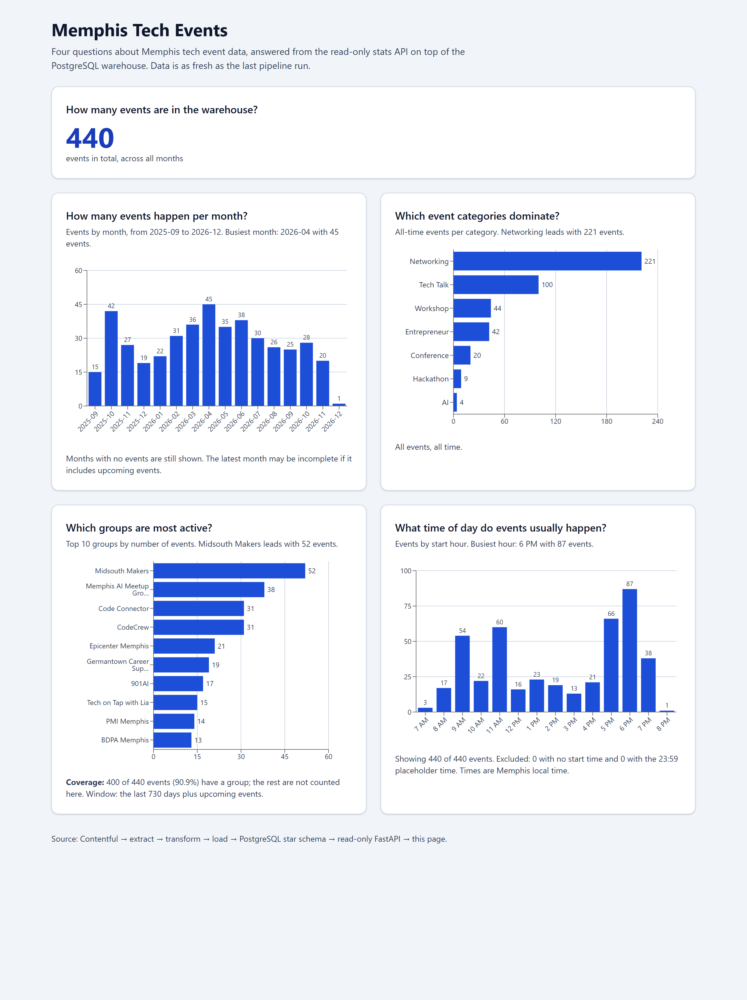
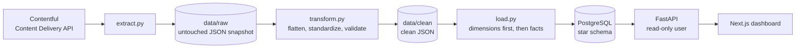
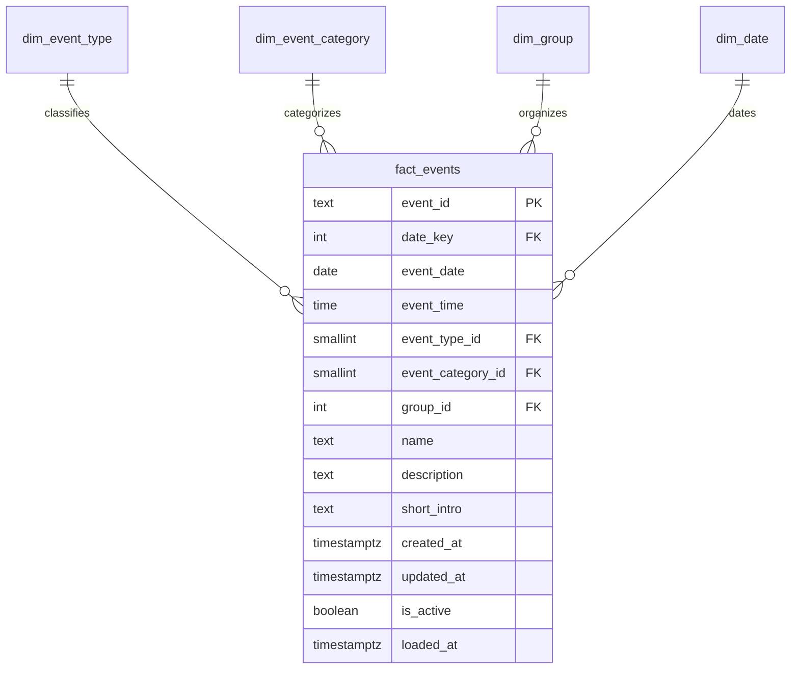

# Memphis Tech Events Data Platform

A data pipeline, PostgreSQL warehouse, read-only API, and dashboard built on real Memphis tech event data from the [Memphis Tech Scene](https://memphistechscene.com) newsletter.



## What it does

Event listings for the Memphis Tech Scene newsletter live in Contentful, a CMS built for publishing, not analysis. This project turns them into something you can query and chart:

- **Extracts** every event from the Contentful Content Delivery API into a dated raw snapshot.
- **Cleans** inconsistent values (spelling, casing, time formats) and validates group IDs against a reference list.
- **Loads** the result into a PostgreSQL star schema with re-runnable upserts.
- **Serves** summary statistics through a read-only FastAPI service.
- **Displays** the answers in a Next.js dashboard.

The dashboard answers four questions: how many events happen per month, which categories dominate, which groups are most active, and what time of day events usually start.

## Architecture



Each stage writes its output to disk or the database, so any stage can be re-run without repeating the ones before it. The raw snapshot is never edited after it is written.

**Stack:** Python 3.13 (pandas, psycopg2, FastAPI, Pydantic, Uvicorn) · PostgreSQL 18 · Next.js 16 with React 19, TypeScript, Tailwind CSS, and Recharts.

## Key numbers

From the loaded warehouse:

| | |
|---|---|
| Events | 440 (2025-09-05 to 2026-12-02, including upcoming events) |
| Event types | In-Person 356 · Virtual 69 · Hybrid 15 |
| Categories | Networking 221 · Tech Talk 100 · Workshop 44 · Entrepreneur 42 · Conference 20 · Hackathon 9 · AI 4 |
| Groups | 30 in the reference list; 400 of 440 events (90.9%) have a real group |
| Duplicate event IDs | 0 |

### Data quality fixes

Before writing any cleaning rule, I counted every distinct value per field. The transform then collapses spelling variants with a lookup table, and flags anything unrecognized instead of guessing.

| Field | Distinct values before → after | Rows corrected |
|---|---|---|
| Event type | 6 → 3 | 38 |
| Event category | 9 → 7 | 2 |
| Start time | 40 → 30 | 17 |

Examples: "In Person" and "INPERSON" became "In-Person"; "4PM" and "0900" became `16:00` and `09:00`.

## Schema

A star schema with one fact table (one row per event) and four dimensions.



Key design decisions (full reasoning in [docs/schema-design.md](docs/schema-design.md)):

- **Event ID as the primary key.** It is Contentful's own ID, so re-running the load cannot create duplicates.
- **Date and time stored separately.** `event_time` is nullable and never filled with a fake value.
- **Catch-all group.** Events without a group point to one placeholder row, so the group key is never null. It is excluded from the "trending groups" results.
- **Soft deletes.** Events missing from a new snapshot are flagged `is_active = false`, never deleted.
- **RSVP excluded.** The source field holds links or "TBD", not counts, so engagement analysis is out of scope.

## Load behavior

`load.py` loads everything in one transaction, in dependency order: groups, event types and categories, dates, then events.

- Events are upserted on `event_id`, so re-running updates existing rows instead of duplicating them.
- Events absent from the new snapshot are flagged inactive. The load refuses to do this if the snapshot contains fewer than half of the currently active events, which guards against a bad extract wiping out the table.
- Rows with missing required fields or an unrecognized type or category are logged and skipped.

## API

Read-only FastAPI service (default port 8000). It connects with a database user that has `SELECT` access only. Interactive docs are available at `/docs` while it runs. Details in [docs/api-design.md](docs/api-design.md).

| Endpoint | Returns |
|---|---|
| `GET /events` | Paginated events (100 per page, newest first). Optional `month` (`YYYY-MM`) and `category` filters. |
| `GET /events/{event_id}` | One event. |
| `GET /stats/events-per-month` | Event counts per month, zero-filled between the first and last month. |
| `GET /stats/events-per-category` | All-time event counts per category. |
| `GET /stats/events-per-hour` | Event counts by start hour. Events with no time are excluded and counted separately. |
| `GET /trending/groups` | Most active groups in the last `days` (default 90, max 730), with coverage figures. |
| `GET /trending/categories` | Most common categories in the last `days`. |
| `GET /health` | Confirms the API can reach the database. |

## Dashboard

A single-page Next.js app. A Server Component fetches from the API on the server and passes the data to Recharts client components, so the browser never calls the API directly and no CORS configuration is needed. Each chart is titled with the question it answers, shows its own error or empty state, and includes a note about its data limits (group coverage, excluded times). Details in [docs/dashboard-design.md](docs/dashboard-design.md).

## Project structure

Everything lives at the repository root. Run every command below from the root.

```
.
├── extract.py            Contentful → data/raw
├── transform.py          data/raw → data/clean
├── load.py               data/clean → PostgreSQL
├── requirements.txt
├── .env.example
├── sql/
│   ├── create_tables.sql
│   └── create_api_user.sql
├── api/                  FastAPI service
├── dashboard/            Next.js dashboard
├── data/
│   └── reference/groups.json
└── docs/                 design docs, case study, screenshots
```

`data/raw` and `data/clean` are git-ignored.

## Getting started

**Prerequisites:** Python 3.13, Node 22, PostgreSQL (developed on 18), and a Contentful space with a Content Delivery API token. The extract step needs access to that space, so you cannot reproduce the data without it.

1. **Install Python dependencies.** From the repository root, create a virtual environment named `.venv`:
   ```
   python -m venv .venv
   .venv\Scripts\activate         # macOS/Linux: source .venv/bin/activate
   pip install -r requirements.txt
   ```
2. **Configure environment variables.** Copy `.env.example` to `.env` in the repository root and fill in the values.

   | Used by | Variables |
   |---|---|
   | `extract.py` | `CONTENTFUL_SPACE_ID`, `CONTENTFUL_ACCESS_TOKEN` (required); `CONTENTFUL_ENVIRONMENT` (default `master`), `CONTENTFUL_CONTENT_TYPE` (optional) |
   | `load.py` | `DATABASE_URL` (or standard libpq `PG*` variables) |
   | API | `API_DB_HOST`, `API_DB_PORT`, `API_DB_NAME`, `API_DB_USER`, `API_DB_PASSWORD` |

3. **Create an empty PostgreSQL database** and point `DATABASE_URL` at it.
4. **Run the pipeline**
   ```
   python extract.py          # writes data/raw/events_YYYY-MM-DD.json
   python transform.py        # writes data/clean/events_clean_YYYY-MM-DD.json
   python load.py --init      # first run: creates tables, then loads
   ```
   After the first run, use `python load.py`. Use `--dry-run` to validate without connecting to the database, or `--file PATH` to load a specific file.
5. **Create the read-only API user.** Replace the `CHANGE_ME` password in `sql/create_api_user.sql`, run it as the `postgres` user (for example in pgAdmin), then put those credentials in `.env`.
6. **Start the API**
   ```
   uvicorn api.main:app --reload
   ```
   Open http://localhost:8000/docs.
7. **Start the dashboard**
   ```
   cd dashboard
   cp .env.example .env.local    # sets API_BASE_URL (default http://localhost:8000)
   npm install
   npm run dev
   ```
   Open http://localhost:3000.

## Limitations

- **The API serves whatever was last loaded.** Changes in Contentful appear only after the pipeline runs again. Nothing is scheduled yet.
- **Group data depends on the source.** 40 of 440 events (9.1%) have no group and sit in the catch-all, which the trending-groups results exclude.
- **No RSVP or engagement data.** The source does not contain counts.
- **A re-created Contentful entry gets a new ID.** The old row is flagged inactive and the new one is inserted as a separate event.
- **No automated tests yet.**

## Documentation

- [Schema design](docs/schema-design.md)
- [API design](docs/api-design.md)
- [Dashboard design](docs/dashboard-design.md)
- [Case study](docs/case-study.md)

## About

Built by [JC Smiley Jr.](https://github.com/jcsmileyjr), founder of [Tech Scene Media](https://memphistechscene.com), on the event data behind the Memphis Tech Scene newsletter.
