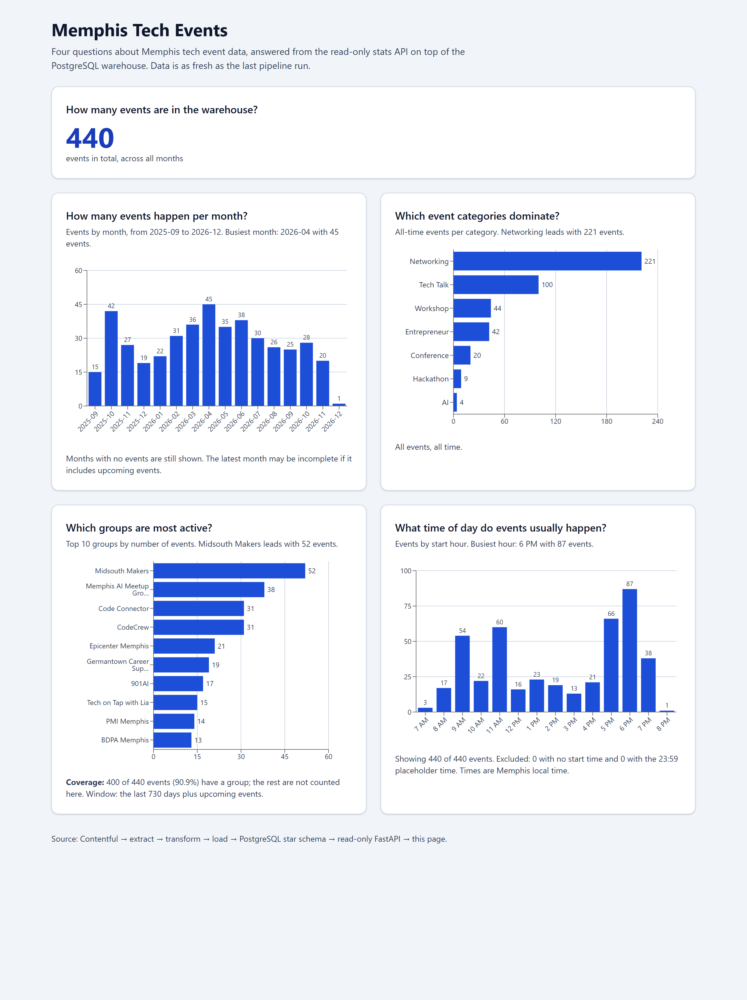
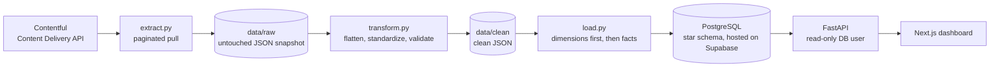
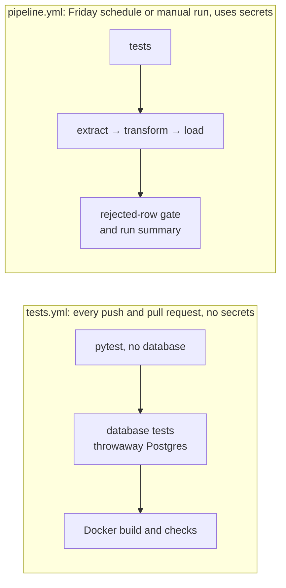
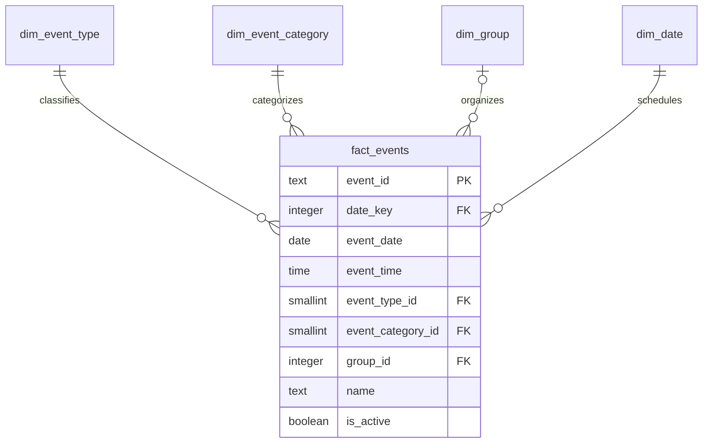

# Building a Production-Style Data Pipeline for 450 Memphis Tech Events

**Python ETL → PostgreSQL warehouse → FastAPI → Next.js dashboard → GitHub Actions → Docker**

I built an automated data pipeline that turns 450 Memphis Tech Scene event listings from a publishing CMS into a clean, queryable PostgreSQL warehouse, then serves that data through an API and dashboard.

The pipeline runs weekly, validates the data before loading it, prevents duplicate records on re-runs, and fails the workflow when rows are rejected.

**Links:** [Code on GitHub](https://github.com/jcsmileyjr/memphis-tech-events-pipeline) · [Test and pipeline runs](https://github.com/jcsmileyjr/memphis-tech-events-pipeline/actions)

---

## What this demonstrates

- **Data engineering:** Python ETL from the Contentful API into PostgreSQL
- **Data modeling:** a star schema designed around the questions the data needed to answer
- **Data quality:** audited the source data before writing cleaning rules
- **Reliability:** re-runnable loads, validation guards, a rejected-row gate, and run summaries
- **Automation:** pytest and GitHub Actions on every push and pull request, plus a scheduled weekly pipeline
- **Delivery:** a read-only FastAPI service and a Next.js dashboard
- **Infrastructure:** a Docker image built and checked in CI

## Results at a glance

| Result | Outcome |
|---|---|
| Events loaded | **450** across 16 months |
| Duplicate protection | A second identical load inserted **0** new rows |
| Data quality | About **9%** of event-type values needed standardizing |
| Time cleanup | **18** inconsistent start times standardized in the latest run |
| Automation | Weekly scheduled pipeline with a run summary |
| Failure protection | The workflow fails when any row is rejected |
| API | Read-only FastAPI service |
| Dashboard | Next.js dashboard answering four analytical questions |

---

## Project takeaway

This project started as a simple question:

> **Can the Memphis Tech Scene's event history become useful data instead of remaining publishing content?**

The result is a repeatable pipeline that takes messy CMS data through extraction, transformation, validation, warehousing, API delivery, and visualization.

More importantly, the project shows the engineering decisions that make a pipeline trustworthy:

**measure the source → design around real questions → preserve raw data → validate aggressively → make loads re-runnable → separate secrets from untrusted code → expose only what consumers need.**

---

# 1. The problem

The Memphis Tech Scene newsletter publishes community technology events every week. The events live in Contentful, a CMS designed for publishing rather than analysis.

That created three practical problems:

1. **The data was difficult to query.** Contentful could store the events, but it had no query layer for questions such as "How many events happen each month?"
2. **The data wasn't consistently structured.** Several fields were free text, so the same value was typed in different ways.
3. **The API response wasn't analysis-ready.** Events arrived as nested JSON with linked entries, not rows and relationships.

### Goal

Turn the publishing data into a **trustworthy, queryable data system** that could:

- preserve the original source data
- clean and validate inconsistent values
- support analytical queries
- refresh automatically
- expose the data through an API
- show the results in a simple dashboard

---

# 2. The solution

I built a small end-to-end data platform:

Each stage has one responsibility and can be re-run without repeating the ones before it.

Two GitHub Actions workflows surround the pipeline:

The separation is intentional: the test workflow never receives real credentials, and the workflow that reads them never runs for pull requests.

---

# 3. Architecture

**Data:** Python, requests, pandas, PostgreSQL, SQL
**Warehouse:** Supabase-hosted PostgreSQL
**API:** FastAPI, Pydantic
**Frontend:** Next.js 16, React 19, TypeScript, Tailwind CSS, Recharts
**Testing:** pytest
**Automation:** GitHub Actions
**Containerization:** Docker

The warehouse is a star schema with one fact table and four dimensions. The fact table is keyed by Contentful's source event ID.

The schema was designed around four questions:

- How many events happen per month?
- Which categories dominate?
- Which groups are most active?
- What time of day do events usually start?

That kept the warehouse focused on real analytical needs instead of modeling every field just because the source had it. Dates are stored as a `DATE` plus a nullable `TIME`, matching the source (a date and a Memphis wall-clock time). A missing time stays NULL and no time zone conversion can shift an evening event to the next day.

---

# 4. Data quality: audit first, then transform

One of the most important decisions was to **profile the real data before writing cleaning rules**.

The audit showed that several assumptions about the source were wrong. For example:

- Event types appeared in several formats: `In Person`, `INPERSON`, `VIRTUAL`.
- Start times appeared as `18:00`, `9:15`, `0900`, `1730`, `4PM`, and `11AM`.
- The group field was more complete than I expected. Every event had a group ID, but 40 of the latest 450 used the source's "Random Group" catch-all, so 410 (91.1%) have a real group.
- RSVP data was a registration link, not an attendance count, so it could not support engagement analysis.
- Only 4 events were labeled AI even though more were AI-focused. I relabeled them at the source, and the latest run shows 39.

Instead of hiding those problems inside transformation code, I used the audit to decide what the pipeline should do.

### Example: event type normalization

The pipeline standardizes known variations through a lookup table, not one-off fixes. Unknown values are flagged, not guessed. My manual count of 38 rows that needed fixing became the check: the script found the same 38.

### Example: time normalization

The pipeline converts mixed time formats into `HH:MM`. One `23:59` value looked like a placeholder, not a real start time. I corrected it in Contentful instead of teaching the pipeline to hide the bad source value. That keeps the pipeline defensive while also improving the source system.

### What the warehouse shows

Event types are mostly In-Person (364), then Virtual (70) and Hybrid (16). Networking leads categories with 180 events, then Tech Talk (109) and Workshop (46). Events peak at 45 in April 2026, and the most active group is Midsouth Makers with 54.

---

# 5. Reliability and data integrity

The pipeline is designed to be safe to run repeatedly.

### Idempotent loading

The loader uses the source event ID as the key and performs an upsert. I verified the behavior against the hosted database:

| Run | Result |
|---|---|
| First load | 450 inserted, 0 updated |
| Second load of the same data | 0 inserted, 450 updated |

The warehouse stayed at 450 events. That test matters because "re-runnable" is only a design claim until the second run proves it.

### Protecting against bad extracts

Removed events are flagged as inactive instead of deleted. The loader also refuses a snapshot that is less than half the current warehouse size, which protects the warehouse from mass deactivation if an extract unexpectedly returns a tiny dataset.

### Rejected-row gate

The loader can skip invalid rows and still exit successfully, so a technically successful workflow could produce an incomplete warehouse. I added a gate that turns the run red if any rows are rejected. The run summary reports the extract, transform and load counts so the result is visible instead of buried in logs.

---

# 6. Automation and CI/CD

### Test workflow

Runs on every push and pull request. It:

- runs the test suite
- runs database tests against a throwaway PostgreSQL container
- fails if database tests are unexpectedly skipped, since a skipped test looks green but proves nothing
- builds and checks the Docker image
- uses no repository secrets

### Pipeline workflow

Runs every Friday night (Central time) and can also be started manually, with an optional dry run. It:

1. runs the non-database tests
2. extracts the current Contentful data
3. transforms and validates it
4. loads PostgreSQL
5. fails if any row was rejected
6. writes a run summary
7. stores the raw and clean files as artifacts for 30 days

**Pull-request code should never have access to real credentials.** That was one of the most important design decisions in the project. The pipeline workflow also masks pieces of the database connection string so a connection error can't leak them into a public log, and a concurrency rule stops two loads from running at once.

### Docker

The pipeline has a multi-stage Dockerfile. The runtime image runs as a non-root user and contains no tests, `.env` files or generated data. CI verifies each of those on every push. The image is built and checked in CI but is not yet used by the weekly run, which executes the Python scripts directly.

---

# 7. API and dashboard

A read-only FastAPI service sits on top of the warehouse. Its database user has `SELECT` access only, so a bug or malformed request cannot modify the warehouse.

The main endpoints provide paginated events, a single event, events per month, events per category, events by start hour, recent activity by group and by category, and health status. "Trending" means event counts over a recent window (90 days by default), because the source has no RSVP numbers and popularity can't be measured.

The dashboard is a Next.js application that answers the four questions the warehouse was designed around. It fetches from the API in Server Components, so the browser never calls the API directly. Each chart handles its own error and empty states and notes the limits of its data.

---

# 8. Engineering decisions that mattered

The most important decisions were not the choice of frameworks. They were decisions about **what the data meant and how the system should behave when something went wrong.**

### Keep the raw snapshot
Raw API data is preserved before transformation, so cleaning rules can be changed and re-run without hitting the source API again.

### Use the source event ID
The source ID is a stable key for upserts and duplicate protection.

### Don't invent missing data
I removed RSVP-based questions because the source held registration links, not attendance counts.

### Model the catch-all honestly
"Random Group" is the source's catch-all for events without a real group. I kept it as a real source value and added an `is_catch_all` flag so group rankings can exclude it without hard-coding an ID.

### Keep the API narrow
The API is built around the dashboard's actual needs, not every warehouse field.

### Use a read-only database account
The API only needs `SELECT`, so it has no permission to modify data.

### Separate trusted and untrusted execution
Tests run on pull requests without secrets. The pipeline that reads secrets runs only on a schedule or by hand.

---

# 9. How I worked with AI

I used AI coding tools as implementation assistance, not as the decision-maker. I defined the analytical questions and schema decisions, used Claude Code to profile the data and help draft the code, then reviewed the output against my own audit.

Several decisions were mine and changed the implementation:

- I rejected RSVP as a meaningful metric.
- I identified "Random Group" as a catch-all, not a real organization.
- I corrected the `23:59` source value instead of adding a transformation rule.
- I chose to keep `dim_date` and to preserve removed events with `is_active`.
- I defined what "trending" means for this dataset.
- I limited the API to what the dashboard needs.
- I chose Next.js after trying Power BI and not getting on with its workflow.
- I ran the load twice against the hosted database to verify the re-run behavior myself.

The important part was not generating code quickly. It was **reviewing the output against the data and overriding the implementation when the evidence required it.**

---

# 10. What I learned

### Profile the data before designing the pipeline
Several assumptions in my original project brief were wrong. Measuring the real data early kept them from becoming architecture.

### Test behavior, not just code paths
Loading the same data twice and checking that no duplicates appear proves more than checking that an upsert function exists.

### A successful process can still produce a bad result
The rejected-row gate exists because a job that exits cleanly can still leave incomplete output.

### What I'd do differently
Write the tests and schedule the pipeline from the start, not after the first manual loads. Doing so would have caught problems sooner and kept the warehouse current from the first week.

---

# 11. Limitations and next steps

This project is intentionally not presented as a finished production platform.

- The warehouse refreshes weekly, not continuously. GitHub disables scheduled workflows after 60 days without repository activity, and the free Supabase project can pause when idle. Either one stops the weekly load until I re-enable it.
- RSVP or attendance data isn't available, so "trending" shows where organizers put their events, not what attendees choose.
- About 9% of events have no real group, so group rankings should show their coverage.
- Historical data begins in September 2025.
- Only a start time is stored, with no end time, venue or address.
- Removed-event handling is implemented but hasn't been exercised against a real removal.
- Tests cover the pipeline only, not the API or dashboard.
- The Docker image is not used by the weekly run.
- There is no alerting beyond a failed GitHub Actions run.

### Next

1. Add API tests.
2. Add a Power BI report on the same warehouse.
3. Run the weekly pipeline from the Docker image, or remove the unused image.
4. Add stronger operational alerting.
5. Consider Contentful's Sync API for incremental loads and explicit deletions.

---

# Technical appendix

The sections below are for readers who want implementation-level detail.

## Data audit

The first audit covered 435 entries from the 2026-10-29 snapshot. The latest snapshot has 450.

- **Event type:** 6 distinct values where 3 were expected. 38 of 435 rows (about 9%) needed normalization. The latest run standardized 39 values.
- **Event category:** 9 distinct values where 7 were expected. `WORKSHOP` and `Tech TalkNetworking` (two categories run together) were the errors. I mapped the second to "Tech Talk", a judgment call I documented.
- **Time:** 41 distinct representations in the first audit, 30 after normalizing to `HH:MM`. The latest run standardized 18 values.
- **Groups:** 30 source groups, all used. 410 of 450 events (91.1%) have a real group.
- **RSVP:** 424 URLs and 16 `TBD` values, so attendance analytics were removed from the design.
- **Repeated names:** 3 pairs of events shared a name and date but had different IDs. I confirmed they are separate events and kept all of them.

## Warehouse schema

| Table | Rows | Purpose |
|---|---|---|
| `fact_events` | 450 | One row per event |
| `dim_event_type` | 3 | In-Person, Virtual, Hybrid |
| `dim_event_category` | 7 | Networking, Tech Talk, Workshop, Entrepreneur, Conference, Hackathon, AI |
| `dim_group` | 30 | Community groups plus the catch-all flag |
| `dim_date` | 3,774 | Calendar days from 2025-09-01 to 2035-12-31 |

## API

| Endpoint | Purpose |
|---|---|
| `GET /events` | Paginated events with optional filters |
| `GET /events/{event_id}` | Single event |
| `GET /stats/events-per-month` | Monthly event counts |
| `GET /stats/events-per-category` | Category counts |
| `GET /stats/events-per-hour` | Event counts by start hour |
| `GET /trending/groups` | Active groups over a recent window |
| `GET /trending/categories` | Active categories over a recent window |
| `GET /health` | Database connectivity check |

The API returns a deliberately small event shape because the dashboard is its only consumer.

## Problems I hit

### Contentful returned a 401
The Space ID was correct, so I tested the credentials separately from the request. The cause was the wrong token type: the Content Delivery API only accepts its own token.

### pandas converted group IDs to decimals
Because the group column had gaps, pandas turned integer IDs into floats such as `9.0`, which would break the join to the group table. I converted the column to a nullable integer type, and the loader converts it to a whole number before writing.

### The project brief didn't match the data
The brief described 435 entries, history from October 2024, and sparse group data. The data had more than 440 entries from September 2025, with a group ID on every event and 40 using the catch-all. The design follows the measured data, not the brief.

### `updated_at` wasn't useful for recency
A bulk edit made 298 of 440 records share one `updated_at` date, so I used `created_at` instead.

### Supabase connection details
GitHub Actions runners are IPv4-only, so I used the Supabase session pooler, which needs a username that includes the project reference (`postgres.<project-ref>`). The read-only API user follows the same pattern.

