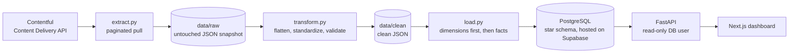
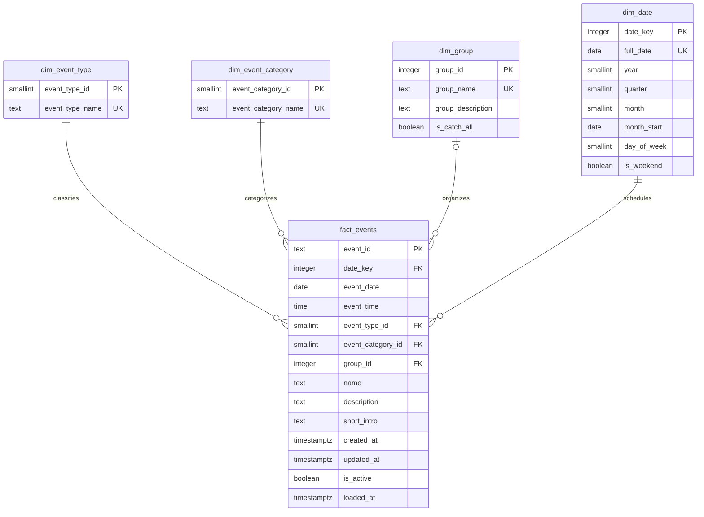

# Memphis Events Pipeline: From a Newsletter CMS to a Queryable Warehouse, API, and Dashboard

## Summary

I turned about 16 months of Memphis tech event listings (September 2025 through December 2026, including upcoming events), stored in a publishing CMS, into a clean, queryable PostgreSQL warehouse with a read-only API and a dashboard on top. A Python pipeline pulls the events from Contentful, cleans inconsistent values, and loads them into a star schema hosted on Supabase. Loading the same file twice leaves the row count unchanged: the first run inserted 450 events, and the second inserted none and updated 450. A small FastAPI service serves the data through a database user that can only read, and a Next.js dashboard answers four questions about the Memphis tech event scene. A GitHub Actions workflow runs the pipeline every Friday night after its tests pass, and a pytest suite and a Docker image check every push.

**Stack:** Python (requests, pandas, psycopg2), Contentful Content Delivery API, PostgreSQL (hosted on Supabase), SQL (star schema), FastAPI, Pydantic, Next.js 16, React 19, TypeScript, Tailwind CSS, Recharts, pytest, GitHub Actions, Docker.

## The problem

The Memphis Tech Scene newsletter publishes community events every week. Those events live in Contentful, a CMS built for publishing content, not for analysis. That created three problems:

- **No way to ask questions of the data.** Contentful has no query layer for questions like "how many events per month?" or "which categories dominate?"
- **Nothing enforced consistency.** Fields were free text, so the same value was typed several ways.
- **Awkward shape.** The API returns nested JSON with linked entries, not rows and columns.

**Goal:** make the event history queryable, trustworthy, and visible: clean data in a warehouse, served through an API, and shown in a dashboard.

## Architecture

Each stage has one job and writes its output to disk or the database, so any stage can be re-run without repeating the ones before it.

Around those stages, a scheduled GitHub Actions workflow runs the tests and then extract, transform, and load, and a separate workflow tests and builds the Docker image on every push (see "Automation, tests, and container").

## Key decisions and trade-offs

| Decision | Why | Trade-off |
|---|---|---|
| Paginated extract, not a single request | A single request silently misses entries past the page limit | More code, but correct |
| Keep the raw snapshot untouched | Cleaning can be re-run without hitting the API again, and raw data is never lost | Extra files on disk |
| Separate extract, transform, and load scripts | Each can be tested and re-run on its own | More files to manage |
| Fail loudly on 4xx errors, retry only on 429 and 5xx | Bad credentials should stop the run, not be retried | Needs manual fixes when credentials break |
| Standardize with a lookup table, not hand-fixes | Handles spelling variants I haven't seen yet | Unknown values are flagged, not guessed |
| Star schema with one fact table and four dimensions | Built for the questions I want to ask (counts by month, category, group, time of day) | More joins than one flat table |
| Upsert on the Contentful event ID | Re-running the pipeline can't create duplicates | Needs a separate rule for removed events |
| Flag removed events (`is_active = false`) instead of deleting them | Keeps history and is reversible if an event comes back | One extra column; queries must filter on it. The loader refuses to run if the snapshot is under half the size of the warehouse, so a failed extract can't deactivate everything |
| Date and time stored as a `DATE` plus a nullable `TIME` | Matches the source (a date and a wall-clock time, no time zone). All events are in Memphis (America/Chicago), and a missing time stays NULL instead of an invented value. A single timestamp would force a fake time, and a timestamp with time zone would add DST conversion and shift day boundaries (a 7 PM Central event falls on the next day in UTC) | Two columns to combine when an exact instant is needed |
| Events with no group use the source's own "Random Group" row, flagged `is_catch_all` | The source already uses it as the bucket for events with no group, so there is nothing to invent. The flag keeps it out of group rankings without a hard-coded ID in every query | The catch-all must be excluded from group questions |
| Registration links not stored | The source field is a URL (or `TBD`), an address and not a countable measure. Nothing in the questions needs it | The API can't link out to registration pages |
| Event details (name, description, intro) on the fact table | One row per event, so a separate event dimension would add a join and a second key for no analytical gain | A wider fact table than textbook |
| Compute month, weekday and hour in queries | They can be derived from the date and time, and stored copies could drift. Only the `dim_date` key is stored | Slightly longer queries |
| API connects as a database user with `SELECT` only | Even a bug or a bad request can't change the warehouse | A separate user and password to set up |
| API built around the dashboard's four questions, not a general events API | The dashboard is the only consumer, so the endpoints return summaries (events per month, category, hour, trending) and a small event shape, not every field | Not a general-purpose events API |
| "Trending" means what organizers are focused on: event counts by group and by category over a recent window | There are no RSVP numbers, so popularity can't be measured. Counts in the last N days (default 90) show where organizers put their effort | Reflects supply of events, not attendance |
| Dashboard fetches the API from the server (Next.js Server Components) | The browser never calls the API, so there is no CORS setup and the API address stays server-side | The dashboard needs the API running to render |
| Next.js dashboard instead of Power BI | I tried Power BI first and didn't get on with the workflow. A Next.js app keeps the dashboard in code I can version, review, and run with the rest of the project | More front-end code to write than dragging visuals onto a canvas |
| Hosted Postgres (Supabase) instead of only a local database | A scheduled job can't reach a database on my laptop, so a hosted one was the first step toward running the pipeline automatically. The weekly workflow now loads into it | A free tier has limits (an idle project can pause), and the connection details (pooler, credentials) need care |
| Scheduled GitHub Actions workflow (Friday night, Central time) | The warehouse stays current without me running three scripts by hand, and a manual "Run workflow" button with a dry-run option covers the times I want to check first | Cron runs in UTC and ignores daylight saving, so the local time shifts by an hour twice a year. GitHub also disables scheduled workflows after 60 days without repository activity |
| Pipeline workflow runs only on a schedule or by hand, never on pushes or pull requests | It reads real secrets (Contentful token, database URL), so code from a pull request must never be able to run it | I can't see a pipeline run for every change, so the test workflow has to cover that |
| Separate test workflow with no secrets, using a throwaway Postgres container | Every push and pull request gets the full suite, including the database tests, without touching the real warehouse. The test fixture refuses any host except localhost and anything containing "supabase" | The database tests run against a local Postgres, not Supabase, so a Supabase-specific problem would not show up |
| Run summary page and a gate that fails the run on rejected rows | The loader exits successfully when it skips bad rows, so a rejected event could go unnoticed. The gate turns the run red, and the summary shows the extract, cleaning, and load counts for each run | The summary parses the scripts' log messages, so rewording a message breaks it. A test runs the real scripts to catch that |
| Docker image for the pipeline only, in a multi-stage build (a test stage and a runtime stage) | The same code runs the same way anywhere, and the runtime image has no tests, no pytest, no `.env` files, and no secrets. Secrets are passed when the container runs, never baked in | The base image is pinned by digest for reproducible builds, so I have to update it by hand to get security patches. The API and dashboard are not in the image |

## What the data looked like

I audited the entries by counting the exact string values per field before writing any cleaning rules. The first audit covered 435 entries (the 2026-10-29 snapshot). The latest snapshot (2026-11-19) has 450. Counts below are from the first audit unless a bullet says "latest".

- **Event type (attendance format):** 6 distinct values where there should be 3. "In Person" (36 rows), "INPERSON" (1), and "VIRTUAL" (1) were variants of "In-Person" and "Virtual". **38 of 435 rows (about 9%)** needed fixing. The latest run standardized 39 values.
- **Event category:** 9 distinct values where there should be 7. "WORKSHOP" and "Tech TalkNetworking" (two categories run together) were the errors. I mapped the second to "Tech Talk", which is a judgment call I documented. 2 rows needed fixing. The latest run standardized 1 value.
- **Time:** 41 distinct values in mixed formats: `18:00`, `9:15`, `0900`, `1730`, and `4PM`/`11AM`. I normalized them to 24-hour `HH:MM`. **17 rows changed** and every value parsed, leaving 30 distinct values. The latest run changed 18 rows and also leaves 30 distinct values, all in `HH:MM` format, with no event missing a time. One value, `23:59`, looked like a placeholder, not a real start time (1 event, a virtual entrepreneur event on 2026-09-21). I corrected it in Contentful to 17:00, so the pipeline needs no special rule. Older snapshots still contain the `23:59`.
- **Groups (latest):** event groups come from a reference list of 30 community groups. In the latest file every event has a group ID, all 30 groups are used, and every ID exists in the reference list. But 40 events (8.9%) use "Random Group", the source's catch-all for events with no group, so **410 of 450 events (91.1%) have a real group**, spread across all 16 months. Earlier I had expected group data to be sparse. That was wrong for this file, and I only found out by measuring it. An earlier clean file had no group column at all, so loading it would put every event in the catch-all.
- **Categories (latest):** in the first audit only 4 events were labeled AI, even though more of the events were AI-focused. I relabeled AI-focused events at the source in Contentful, and the latest run shows 39 AI events (Networking fell from 221 to 180).
- **RSVP:** in the 440-entry snapshot I audited, the RSVP field was a link, not a count (424 URLs and 16 `TBD`), so engagement analytics weren't possible. I removed RSVP-based questions from the design instead of building on data that doesn't exist, and I decided not to carry the link as a column.
- **History:** the earliest event is 2025-09-05. Many events were recorded in another system and ported into Contentful, so earlier history is not in this warehouse.
- **Repeated names:** in the first audit, 3 pairs of events shared a name and date but had different IDs (for example, "Midsouth Makers Weekly Friday Open House" on 2025-10-03). I checked them, confirmed they are separate events, and kept all of them.

**Root cause:** these were free-text fields. Converting them to dropdowns or validated fields in Contentful would stop new bad values at the source. The pipeline stays defensive either way.

## Schema

Star schema, one fact table with four dimensions. Grain: one row per event, keyed by Contentful's `sys.id`.

| Table | Rows | Key | Purpose |
|---|---|---|---|
| `fact_events` | one per event (450 in the latest load) | `event_id` (text) | Event, its date and time, type, category, group, name, description, intro, timestamps, `is_active` |
| `dim_event_type` | 3 | `event_type_id` | In-Person, Virtual, Hybrid |
| `dim_event_category` | 7 | `event_category_id` | Networking, Tech Talk, Workshop, Entrepreneur, Conference, Hackathon, AI |
| `dim_group` | 30 | `group_id` (the source ID) | Community groups, with the `is_catch_all` flag |
| `dim_date` | 3,774 | `date_key` (YYYYMMDD) | One row per calendar day, 2025-09-01 to 2035-12-31, with year, quarter, month, weekday |

**Questions the schema was designed to answer:**
- How many events per month? (fact joined to `dim_date`)
- Which categories dominate? (fact joined to `dim_event_category`)
- Which groups are most active, shown with coverage? (fact joined to `dim_group`, catch-all excluded)
- What time of day do events usually happen? (hour taken from `event_time`)

`dim_date` is a calendar and never needs a daily update. It is seeded once through 2035, and the loader adds days if an event ever falls past the seeded range.

## The API

A read-only FastAPI service sits on top of the warehouse. It connects with a database user that has `SELECT` access only, validates responses with Pydantic, and serves interactive documentation at `/docs`.

| Endpoint | Returns |
|---|---|
| `GET /events` | Events, 100 per page, newest first, with optional month and category filters |
| `GET /events/{event_id}` | One event |
| `GET /stats/events-per-month` | Event counts per month, with empty months filled in as zero |
| `GET /stats/events-per-category` | All-time counts per category |
| `GET /stats/events-per-hour` | Counts by start hour. Events with no time are left out and counted separately |
| `GET /trending/groups` | Most active groups in a recent window (default 90 days, 1 to 730), with coverage figures. The catch-all is excluded |
| `GET /trending/categories` | Most common categories in the same window |
| `GET /health` | Confirms the API can reach the database |

I kept the event shape small on purpose: name, date, type, category, group name, and event ID. The dashboard is the only consumer, and it doesn't need more.

## The dashboard

A Next.js app with one page. A Server Component fetches from the API on the server and passes the data to Recharts chart components, so the browser never calls the API directly. Each chart is titled with the question it answers, handles its own error and empty states, and carries a short note about its data limits, such as group coverage and events excluded for having no start time.

The four questions: how many events happen per month, which categories dominate, which groups are most active, and what time of day events start.

## Automation, tests, and container

**Tests.** A pytest suite covers the pipeline (not the API or dashboard): the cleaning rules in `transform.py`, the loader's validation and guards, the run-summary script, and the re-run behavior against a real database. The database tests load a tiny fixture file into a throwaway schema and drop it afterward. The tests that need no database run with no secrets and no network.

**Two workflows.**

| Workflow | When it runs | What it does | Secrets |
|---|---|---|---|
| `tests.yml` | Every push and pull request | Runs the tests without a database, then the database tests against a throwaway Postgres container. Fails if a database test is skipped, because a skipped test looks green but proves nothing. Also builds the Docker image and checks it | None |
| `pipeline.yml` | Every Friday night (Central time) and by hand, with an optional dry run | Runs the non-database tests first, then extract, transform, and load. Fails the run if any row was rejected, writes a run summary, and keeps the raw and clean files as an artifact for 30 days | Contentful and database credentials, passed only to the steps that need them |

I kept them separate on purpose. Anything that reads secrets must never run for a pull request, and anything that runs for pull requests must never see a secret. The pipeline workflow also masks the pieces of the database connection string (host, user, project reference) so a connection error can't leak them into a public log, and a concurrency rule stops two loads from running at once.

**Docker.** The pipeline has a multi-stage Dockerfile. The `test` stage adds pytest and the tests, and CI runs it with the network turned off. The `runtime` stage is the image I would actually run. It runs as a non-root user and has no tests, `.env` files, or generated data, and CI checks each of those on every push. CI builds and checks the image but doesn't run the pipeline in it or push it anywhere. The weekly workflow runs the Python scripts directly, not through the container.

## Problems I hit and how I solved them

- **401 from Contentful.** The Space ID loaded correctly, so I suspected the credentials, not the request. The cause was the wrong token type: the Content Delivery API only accepts its own token. Lesson: when the URL is right, test credentials in isolation.
- **`ModuleNotFoundError: pandas`.** The package was installed in a different Python environment than the one running the script. Fixed by activating the virtual environment first, then saving `requirements.txt`.
- **Project layout.** The scripts and `data/` folders originally lived inside the `.venv` folder. I later moved everything to the repository root and kept `.venv/` for the virtual environment only.
- **Group IDs becoming decimals.** pandas turns an integer column with gaps into floats (9 becomes 9.0), which would break the join to the group table. I converted it to a nullable integer type, and the loader converts it to a plain whole number before writing.
- **My assumptions didn't match the data.** The project brief said 435 entries, history from October 2024, and group data for only a few months. The data had more than 440 entries from September 2025, and every event had a group ID (40 of them the catch-all). I profiled the file before designing, so the design followed the data and not the brief.
- **`updated_at` is useless for "recently changed".** In the 440-event snapshot, 298 of 440 rows shared one date (a bulk edit on 2026-11-01), so I based recency on `created_at` instead.
- **Power BI.** I planned to build the dashboard in Power BI because it would add to my toolset, but the workflow didn't suit me. I switched to a Next.js dashboard on the API I had already built.
- **Database connection.** `psql` was installed but not on the PATH, and the first connection to my local database failed with a password authentication error for the `postgres` user.
- **Supabase connection string.** Supabase offers a direct connection and a pooled one. I used the session pooler, which needs a username that includes the project reference (`postgres.<project-ref>`), because the direct address may not be reachable from IPv4-only networks such as GitHub Actions runners. The read-only API user follows the same pattern (`api_reader.<project-ref>`).

## Results

I checked the loader's validation against the real file with a dry run, then loaded the data into a hosted PostgreSQL database on Supabase. The API runs against it, and the dashboard renders all four charts from the API (screenshot at the top).

**Row counts after the load:** `fact_events` 450, `dim_group` 30, `dim_event_type` 3, `dim_event_category` 7, `dim_date` 3,774.

**Re-run test.** I ran the loader twice on the same clean file (450 rows, 0 rejected):

| Run | `fact_events` result | Deactivated |
|---|---|---|
| First (`--init`) | 450 inserted, 0 updated | 0 |
| Second | 0 inserted, 450 updated | 0 |

The event count stayed at 450, so the upsert on the event ID prevents duplicates.

**What the warehouse shows**, queried from the database:
- **Event types:** In-Person 364, Virtual 70, Hybrid 16.
- **Categories:** Networking 180, Tech Talk 109, Workshop 46, Entrepreneur 44, AI 39, Conference 22, Hackathon 10.
- **Events per month:** peaks at 45 in April 2026; September 2025 is a partial first month, and November and December 2026 include upcoming events.
- **Top groups (catch-all excluded):** Midsouth Makers 54, Memphis AI Meetup Group 38, CodeCrew 32, Code Connector 32, Epicenter Memphis 22.

## Limitations and what's next

- **Data freshness.** The API serves whatever was last loaded. The pipeline runs once a week (Friday night), so a change in Contentful can take up to a week to appear unless I start the workflow by hand. GitHub disables scheduled workflows after 60 days without repository activity, and the free Supabase project can pause when idle. Either one stops the weekly load until I re-enable it.
- No RSVP or engagement counts exist in the source, so engagement analysis isn't supported. "Trending" shows where organizers are putting their events, not what attendees choose.
- 8.9% of events have no real group, so any group ranking should show its coverage. Each event has a single category, so an event that is both networking and AI-focused is counted once.
- The data starts in September 2025, so earlier trends can't be answered.
- Only a start time is stored, with no end time, venue or address.
- Removed events are flagged, not deleted. None of the snapshots on disk shows a removal, so that path is untested on real data. Contentful's Sync API handles deletions explicitly and would also make loads incremental.
- The API and dashboard run locally against the hosted database. Automated tests cover the pipeline only, so the API and dashboard have none.
- The Docker image is built and checked in CI but not pushed to a registry or used by the weekly run, and the API and dashboard are not containerized.
- Logging is the scripts' own output plus the run summary. There is no alerting beyond a failed run turning red in GitHub.
- **Next:** tests for the API, a Power BI report on the same warehouse alongside the Next.js dashboard, and either running the weekly job from the Docker image or deleting the image if nothing needs it.

## How I worked

I designed first, then directed AI tools, then reviewed the output. I defined the questions and schema decisions, used Claude Code to profile the data, draft the design docs, and write the SQL, loader, API, and dashboard, and checked the results against my own audit counts. The decisions below were mine, some of them overriding or correcting the draft:

- I decided RSVP stays out of scope and rejected storing the registration link as a column.
- I told the assistant that "Random Group" is a catch-all, not a real organization, which changed how group data is modeled and ranked.
- I fixed the `23:59` placeholder at the source instead of letting the loader hide it.
- I chose to keep `dim_date`, to reuse the source's group IDs as keys, to compute derived columns in queries, and to flag removed events instead of deleting them.
- I confirmed the three repeated name-and-date pairs are separate events, so no deduplication rule was added.
- I defined what "trending" means for this data, and kept the API to the fields the dashboard needs instead of exposing everything.
- I dropped Power BI for a Next.js dashboard after trying it.
- I relabeled AI-focused events at the source in Contentful instead of guessing at labels in the pipeline.
- I ran the load twice against the hosted database to check the re-run behavior myself, instead of relying on the design.

## What I learned

- Count the real values before writing cleaning rules. My manual audit became the test for the pipeline: the script found the same 38 type rows I had counted.
- Keep the raw layer untouched. It made every later fix cheap.
- A column you can't populate shouldn't be in the schema. Removing RSVP kept the design honest.
- Profile the real file before designing. Three assumptions in the brief (the row count, the start date and sparse group data) were wrong, and finding that out early was cheap.
- Test the second run, not just the first. A design that says "re-runnable" proves little until the same file loaded twice leaves the row count unchanged.
- A job that succeeds isn't always a job that worked. The loader exits cleanly when it skips bad rows, so I added a gate that fails the run, and a test check that skipped database tests fail the build.
- Keep secrets and untrusted code apart. Splitting the test workflow (no secrets, runs on every pull request) from the pipeline workflow (secrets, runs only on a schedule or by hand) was the main design decision in the automation.
- **What I'd do differently:** write the tests and schedule the pipeline from the start, not after the first manual loads. Having them earlier would have caught problems sooner and kept the warehouse current from the first week. I'd also add a Power BI report on the same warehouse next to the Next.js dashboard.
