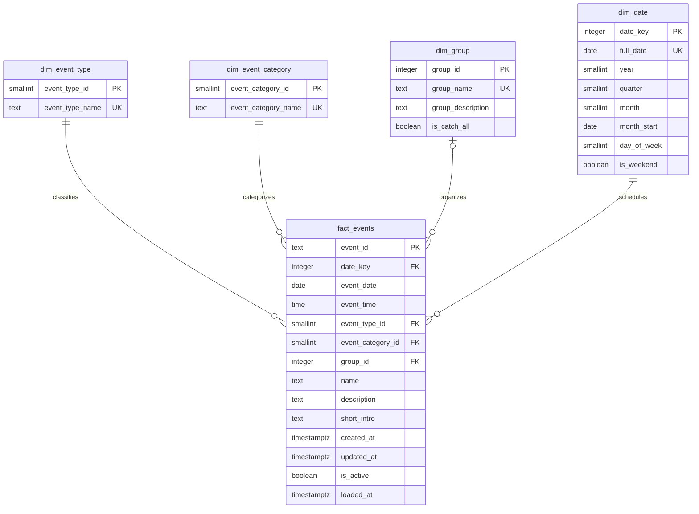

# Memphis Events: PostgreSQL Star Schema Design

Status: draft for review. Measured against `data/clean/events_clean_2026-11-07.json` and `data/raw/events_2026-11-07.json` (extracted 2026-11-07T12:04:56Z). No SQL is included by design; `sql/create_tables.sql` and `src/load.py` come next.

---

## 1. Purpose and scope

Model the cleaned Memphis Tech Scene event data as a small star schema in PostgreSQL so that:

- a read-only Memphis Events API (FastAPI) can serve events by month, by category, by ID and upcoming events;
- a dashboard could later reuse the same warehouse. The schema stores facts and descriptive attributes only. It carries no presentation logic (labels, ordering, chart shapes).

In scope: one fact table (`fact_events`) and its dimensions, the keys and constraints, and the load/upsert rules.
Out of scope: RSVP (see section 9), SQL scripts, loader code, API design.

Where the repo lives: the pipeline scripts (`extract.py`, `transform.py`, `load.py`) and the `data/`, `sql/`, `api/` and `docs/` folders sit at the repository root. Paths below are relative to the repo root.

---

## 2. Data profile

All numbers were measured, not estimated. Source: `events_clean_2026-11-07.json`, an array of 440 objects.

### 2.1 Shape

- Rows: **440**. Columns: **11**: `event_id, created_at, updated_at, name, date, time, event_type, event_category, group_id, description, short_intro`.
- `event_id` is **unique**: 440 distinct values in 440 rows.
- Date range of `date`: **2025-09-05 to 2026-12-02**. All 440 dates parse. 16 events are on or after 2026-11-07 (the extract date).
- `created_at` range: 2025-08-17 to 2026-11-01.

### 2.2 Completeness per column

| Column | Non-null / non-empty | % | Distinct |
|---|---|---|---|
| event_id | 440 | 100.0% | 440 |
| created_at | 440 | 100.0% | 440 |
| updated_at | 440 | 100.0% | 440 |
| name | 440 | 100.0% | 259 |
| date | 440 | 100.0% | 260 |
| time | 440 | 100.0% | 31 |
| event_type | 440 | 100.0% | 3 |
| event_category | 440 | 100.0% | 7 |
| group_id | 440 | 100.0% | 30 |
| description | 440 | 100.0% | 282 |
| short_intro | 440 | 100.0% | 276 |

Text lengths (characters): `description` min 115, median 287.5, max 977; `short_intro` min 43, median 132, max 310; `name` max 115. The longest group name in `groups.json` is 38 characters and the longest group description is 433.

### 2.3 Categorical columns

- `event_type`: In-Person 356, Virtual 69, Hybrid 15.
- `event_category`: Networking 221, Tech Talk 100, Workshop 44, Entrepreneur 42, Conference 20, Hackathon 9, AI 4.
- `time` (30 distinct values, all `HH:MM`): 18:00 (68), 17:30 (43), 19:00 (38), 11:00 (35), 09:00 (27), 09:15 (24), 11:30 (23), 17:00 (22), 13:00 (21), 14:00 (19), 18:30 (19), 16:00 (16), 12:00 (16), 08:00 (12), 15:00 (10), 10:15 (10), 10:00 (8), 16:30 (5), 15:30 (3), 09:30 (3), 08:30 (3), 10:30 (3), 07:30 (2), 13:30 (2), 08:15 (2), 11:15 (2), 17:45 (1), 10:45 (1), 20:00 (1), 07:00 (1).
- Start hours run from 07:00 to 20:00 (all 440 rows). Rough buckets: morning (before 12:00) 156, afternoon (12:00 to 16:59) 92, evening (17:00 and later) 192. The most common single hours are 18:xx (87), 17:xx (66), 11:xx (60), 09:xx (54).

### 2.4 Group field

- **A group field exists** (`group_id`, integer) and is populated on **440 of 440 events (100.0%)**. It covers **every month from 2025-09 to 2026-12**.
- 30 distinct group IDs appear; `data/reference/groups.json` holds 30 groups (`id`, `name`, `description`) and all 30 are used. Every event `group_id` exists in the reference file (0 unknown IDs). Two groups have exactly 1 event.
- Most active groups by event count: Midsouth Makers (id 18) 52; Random Group (id 29) 40; Memphis AI Meetup Group (id 35) 38; CodeCrew (id 27) 31; Code Connector (id 2) 31; Epicenter Memphis (id 20) 21; Germantown Career Support & Networking (id 7) 19; 901AI (id 6) 17.
- **Update (confirmed by you): Random Group (id 29, 40 events) is not a real organization but the catch-all for events with no group.** Real-group events are therefore 400 of 440 (90.9%). The "sparse group data" in the brief is consistent with this: ungrouped events are labelled id 29 rather than left blank.
- Before that confirmation this looked like a contradiction of the project brief's assumption that group data covers only a few months. In the 2026-10-30 clean file the column was absent entirely (it had `rsvp` instead; see 2.5); `group_id` was added to the transform afterwards (commit 95deb15 in the repo history). If another extract ever has gaps, the design below still handles them.

### 2.5 RSVP field

- The **clean** file has **no RSVP column**. The older clean file `events_clean_2026-10-30.json` (435 rows) did have one named `rsvp`.
- The **raw** Contentful snapshot **does** have `fields.rsvp`, populated on **440 of 440 (100%)**. Measured contents: **424 are `http(s)` URLs, 16 are the literal text `TBD`, 0 are anything else.** It is a registration/event link, not RSVP counts or attendee data. This is a surprise relative to "RSVP data does not exist for this dataset"; see sections 9 and 11. RSVP counts/attendance do not exist anywhere in either file, so RSVP analytics stay out of scope.
- Other raw-only fields not in the clean file: `fields.eventId` (440/440; 440 distinct; equal to `sys.id` on 0 of 440 rows, so it is a separate ID), `fields.iconName` (440/440, 7 distinct), `fields.id` (433/440, 3 distinct, looks like a stray numeric field), `sys.publishedVersion`, `sys.revision`.

### 2.6 Placeholder time

- `time = "23:59"`: **0 events** in the 2026-11-07 clean file. The one earlier placeholder (2026-09-21, Entrepreneur, Virtual) was corrected at the source to **17:00** (the 2026-11-07 raw snapshot has no 23:59; the 2026-11-01 raw and 2026-10-30 clean files still had it). All 440 rows now have a plausible start time.
- Separately, the raw file had 41 distinct `fields.time` spellings (e.g. `4PM`, `0900`, `9:15`); the transform normalized all of them to `HH:MM`. Nothing was left unparsed.

### 2.7 Other findings

- **Events per month** (by event date): 2025-09: 15, 2025-10: 42, 2025-11: 27, 2025-12: 19, 2026-01: 22, 2026-02: 31, 2026-03: 36, 2026-04: 45, 2026-05: 35, 2026-06: 38, 2026-07: 30, 2026-08: 26, 2026-09: 25, 2026-10: 28, 2026-11: 20, 2026-12: 1. 2025-09 starts mid-month (first event 2025-09-05) and 2026-11 / 2026-12 include future dates, so those three months are not comparable to full months.
- **The brief says 435 entries from Oct 2024.** The newest clean file has **440** rows (the 2026-10-30 file had 435) and the earliest event date is **2025-09-05**. Nothing earlier than 2025-08-17 exists in `created_at` either.
- **`updated_at` is a poor "recently changed" signal**: 298 of 440 rows share the update date 2026-11-01 (a bulk edit), 62 distinct update dates in total.
- **Repeated (name, date) pairs**: 3 pairs share a name and date with different `event_id`s. Confirmed as separate events, so all are loaded and counted. Do not treat them as duplicates when comparing distinct names (259) with rows (440).
- Weekday spread (event date): Wednesday 106, Friday 91, Thursday 88, Saturday 67, Tuesday 54, Monday 33, Sunday 1.
- Category by type (cross-tab) has no empty `event_type` or `event_category`; no value falls outside the allowed sets.

---

## 3. Analytical questions

A question is "supported" when the tables can answer it, regardless of how it is presented.

| # | Question | Who asks | Columns / joins needed | How it could be presented | Caveats |
|---|---|---|---|---|---|
| 1 | How many events happen per month? | Community members; organizers; dashboard viewers | `fact_events.date_key` join `dim_date` (`year`, `month`, `month_start`) ; `COUNT(*)` grouped by month | Dashboard: monthly bar/line tile. API: `GET /stats/events-per-month` | Only 2025-09 to 2026-12 exists. First (2025-09) and last (2026-11, 2026-12) months are partial or future. Counts by event date, not by creation date. |
| 2 | Which event categories dominate? | Organizers; sponsors | `fact_events.event_category_id` join `dim_event_category`; `COUNT(*)` | Dashboard: ranked bar. API: `GET /stats/events-per-category` | Current split: Networking 221 of 440 (50.2%). AI has only 4 events, so shares for small categories are noisy. Category is single-valued per event (a cleaning rule collapsed "Tech TalkNetworking" into Tech Talk). |
| 3 | Which groups are most active? | Group organizers; community members | `fact_events.group_id` join `dim_group`; `COUNT(*)` where `dim_group.is_catch_all = false` | Dashboard: top-N bar plus a coverage note. API: `GET /trending/groups` | Scope the query to events that have a group and return coverage alongside (events with group / total events). Today 440 / 440 events carry a `group_id`, but 40 of them are the catch-all (Random Group, id 29), so real-group coverage is 400 / 440 (90.9%). Catch-all events fall in 11 of the 16 months. "Random Group" (id 29, 40 events) is confirmed as a catch-all for events with no real group, so exclude it from rankings and report coverage as real-group events / total: 400 / 440 (90.9%). |
| 4 | What time of day do events usually happen? | Attendees planning their week; organizers scheduling | `fact_events.event_time` (derive hour in the query or a stored column); exclude NULL times | Dashboard: histogram by hour or bucket. API: optional `GET /stats/events-per-hour` | The single `23:59` placeholder in earlier extracts was corrected at the source to 17:00, so no exclusion is needed today; queries should still ignore NULL times. Times are local Memphis wall-clock times with no time zone. Start time only; there is no end time or duration in the data. |
| 5a | Events by month (API) | API consumers | Same as Q1 | `GET /stats/events-per-month` | Same as Q1 |
| 5b | Events by category (API) | API consumers | Same as Q2 | `GET /stats/events-per-category` | Same as Q2 |
| 5c | One event by ID (API) | API consumers; drill-down | `fact_events` by `event_id`, join `dim_event_type`, `dim_event_category`, `dim_group` | `GET /events/{event_id}` | Returns 404 for unknown IDs; `event_id` is Contentful's `sys.id` (a string, not an integer). |
| 5d | Upcoming events (API) | Attendees | `fact_events.event_date >= current_date in America/Chicago`, order by `event_date`, `event_time` | not implemented (proposed `GET /events/upcoming`) | Today (2026-11-07) 16 events are upcoming. Rows with NULL time sort last within a day. "Today" must be computed in America/Chicago, not UTC. |
| 5e | "Trending" events (no RSVP) | Attendees | See proposal below | `GET /trending/groups` and `GET /trending/categories` | **Decision for you.** Without RSVP, popularity cannot be measured. |
| 6 | Filters and drill-down: month/quarter, category, event details | Dashboard viewers; API consumers | `dim_date` (`year`, `quarter`, `month`), `dim_event_category.category_name`, `fact_events.name`, `description`, `short_intro` | Dashboard: filter controls and detail panel. API: query params `?month=2026-03`, `?quarter=2026-Q1`, `?category=Workshop` | Details live on the fact table (one row per event, text attributes) rather than a separate dimension; see section 8.4. |

**Proposed definition of "trending" (decision for you, not made here).** No RSVP, attendance, view or click data exists, so "trending" can only mean something about recency. Candidates:

1. **Happening soon**: upcoming events in the next 14 days, ordered by date. Clean and defensible; effectively a filtered "upcoming" list.
2. **Recently added**: upcoming events ordered by `created_at` descending ("new on the calendar"). `created_at` is meaningful (range 2025-08-17 to 2026-11-01).
3. **Recently updated**: not recommended. 298 of 440 rows share `updated_at` 2026-11-01 from a bulk edit, so it would rank nearly everything equally.

Recommendation (see also the expanded options below): option 2 combined with option 1 (upcoming events, newest-added first, within the next 30 days), and name the endpoint `featured` or `new` rather than `trending` so it does not imply popularity. This needs `created_at` stored on the fact table.

**Trending options (no RSVP), with counts as of 2026-11-07.** Upcoming = 16 events; 13 fall within 7 days, 15 within 14 days, all 16 within 30 days.

| Option | Definition | Needs | Today's result | Weakness |
|---|---|---|---|---|
| A. Happening soon | Upcoming events in the next 7 or 14 days, by date and time | `event_date`, `event_time` | 13 (7 days) / 15 (14 days) | Just a short "upcoming" list |
| B. Newly added | Upcoming events by `created_at` descending | `created_at` | 14 of 16 upcoming were created in the last 30 days | Mostly the same events as A at this horizon |
| C. Active groups | Upcoming events from groups with the most events in the last 90 days (catch-all excluded) | `group_id`, `is_catch_all` | Last-90-day leaders: Memphis AI Meetup Group 14, Midsouth Makers 9, Epicenter Memphis 7, Code Connector 5 | Measures the group, not the event; 1 of 16 upcoming is catch-all |
| D. Category momentum | Upcoming events in categories whose share is rising versus the prior 90 days | `event_category_id`, `event_date` | Not computed | Small categories (AI 4, Hackathon 9) swing wildly |
| E. Recurring series | Upcoming events whose name has repeated 3+ times in the past | `name` | Not computed | Name matching is fragile (259 names over 440 rows) |
| F. Editor's pick | A manual `is_featured` flag set in Contentful | new source field | n/a | Not in the data; needs a source change |

`updated_at` is excluded because 298 rows share one bulk-edit date.

---

## 4. Grain statement

**One row in `fact_events` represents one event, as identified by its Contentful `sys.id` (`event_id`).** Recurring events (for example the weekly Midsouth Makers open house) are separate Contentful entries and therefore separate rows. No recurrence modeling is attempted. The fact table carries no numeric measures other than the implicit count (`COUNT(*)`); this is a factless-style fact table. That is acceptable here because every analytical question is a count or a filter over events.

---

## 5. Dimension tables

All dimensions use an integer surrogate primary key and a `UNIQUE` constraint on the descriptive value. Names start with `dim_`.

### 5.1 `dim_event_type`

| Column | Type | Key / constraint | Notes |
|---|---|---|---|
| event_type_id | smallint (identity) | PK | surrogate key |
| event_type_name | text | NOT NULL, UNIQUE | In-Person, Virtual, Hybrid |

Why: lets the API filter or group by type and keeps the allowed values in one place. Optional `CHECK`: none needed, the dimension itself is the allowed list. 3 rows today.

### 5.2 `dim_event_category`

| Column | Type | Key / constraint | Notes |
|---|---|---|---|
| event_category_id | smallint (identity) | PK | surrogate key |
| event_category_name | text | NOT NULL, UNIQUE | Networking, Tech Talk, Workshop, Entrepreneur, Conference, Hackathon, AI |

Why: serves Q2 and the category filter (Q6). 7 rows today. A new category in the source requires a new row; see section 10 for what the loader does with an unknown value.

### 5.3 `dim_group`

| Column | Type | Key / constraint | Notes |
|---|---|---|---|
| group_id | integer | PK | **Not a generated surrogate**: reuse the `id` from `data/reference/groups.json` and the events' `group_id`. See below. |
| group_name | text | NOT NULL, UNIQUE | e.g. "Midsouth Makers" |
| group_description | text | NULL allowed | from `groups.json` `description` |
| is_catch_all | boolean | NOT NULL, default false | true only for "Random Group" (id 29): the source's bucket for events with no group. Q3 filters on `is_catch_all = false`. Set by the loader from a constant, since `groups.json` has no such field. |

Why: serves Q3. The source already supplies a stable numeric ID, so keeping it as the key means `fact_events.group_id` loads without a lookup. This is a deliberate deviation from "generated surrogate key". It is still a numeric key with a unique constraint on the name, but it is a source-assigned ID rather than a database-generated one. Decided: reuse the source ID as the key. 30 rows today, loaded from `groups.json`, not from the events.

### 5.4 `dim_date`

| Column | Type | Key / constraint | Notes |
|---|---|---|---|
| date_key | integer | PK | `YYYYMMDD`, e.g. 20260921. A smart key by convention for date dimensions. |
| full_date | date | NOT NULL, UNIQUE | the calendar date |
| year | smallint | NOT NULL | |
| quarter | smallint | NOT NULL, 1 to 4 | |
| month | smallint | NOT NULL, 1 to 12 | |
| month_name | text | NOT NULL | e.g. "March" (descriptive label; harmless but could be dropped if you want zero presentation concerns) |
| month_start | date | NOT NULL | first day of the month; a clean group-by and sort key |
| day_of_week | smallint | NOT NULL, 1 to 7 | ISO: 1 = Monday |
| day_name | text | NOT NULL | |
| is_weekend | boolean | NOT NULL | |

Why: serves Q1 and the month/quarter filter (Q6) and keeps calendar attributes in one place. Populate it from a continuous date range, not only dates that have events, so months with zero events still appear in a monthly chart. **Seed it once from 2025-09-01 through 2035-12-31 (about 3,700 rows)**; it is a calendar, so it does not need a daily update. 260 distinct event dates exist today.

Unlike the other dimensions, `dim_date` uses the conventional `YYYYMMDD` integer key instead of an arbitrary sequence. It is numeric and unique, and it is stable across reloads, which makes the dimension safe to rebuild.

---

## 6. Fact table: `fact_events`

Primary key: `event_id`. Foreign keys point to the dimensions above.

| Column | Postgres type | Key | Nullable | Source | Why it is here |
|---|---|---|---|---|---|
| event_id | text | **PK** | NOT NULL | clean JSON `event_id` | Contentful `sys.id` (21 or 22 characters: 385 rows have 22, 55 have 21). Natural key and upsert conflict target. Serves Q5c. |
| date_key | integer | FK to `dim_date.date_key` | NOT NULL | derived from clean `date` | Q1, Q6, Q5d. |
| event_date | date | | NOT NULL | clean JSON `date` | Upcoming (Q5d) and ordering without a join. Redundant with `date_key`; see 8.2 and 8.4. |
| event_time | time (without time zone) | | **NULL allowed** | clean JSON `time` | Q4 and upcoming-ordering (Q5d). NULL only if a future extract has a missing time (0 today). |
| event_type_id | smallint | FK to `dim_event_type` | NOT NULL | lookup from clean `event_type` | Filter/group by type (Q5c detail, Q6). |
| event_category_id | smallint | FK to `dim_event_category` | NOT NULL | lookup from clean `event_category` | Q2, Q6. |
| group_id | integer | FK to `dim_group.group_id` | NOT NULL | clean JSON `group_id` | Q3. Events with no group use the Random Group row (id 29); see 8.1. |
| name | text | | NOT NULL | clean JSON `name` | Event details (Q5c, Q6). |
| description | text | | NULL allowed | clean JSON `description` | Event details (Q6). 100% populated today; allow NULL so one blank entry does not fail a load. |
| short_intro | text | | NULL allowed | clean JSON `short_intro` | Event details (Q6), list views. |
| created_at | timestamptz | | NOT NULL | clean JSON `created_at` | "Recently added" proposal for Q5e. ISO strings with `Z`. |
| updated_at | timestamptz | | NOT NULL | clean JSON `updated_at` | Change detection on upsert (skip rows where it is unchanged) and audit. Not used for ranking (see 2.7). |
| event_hour | smallint | | NULL allowed | **derived** from `event_time` | Q4. See below. |
| event_month | date | | NOT NULL | **derived** from `event_date` | Q1/Q6. See below. |
| event_day_of_week | smallint | | NOT NULL | **derived** from `event_date` | Weekday analysis. See below. |
| has_description | boolean | | NOT NULL | **derived** from `description` | Data-quality flag. See below. |
| is_active | boolean | | NOT NULL, default true | pipeline metadata | False when the event no longer appears in the latest snapshot (deleted or unpublished in Contentful). The row is kept. All API and dashboard queries filter `is_active = true` unless they want history. |
| loaded_at | timestamptz | | NOT NULL | pipeline metadata | When the row was last upserted by `load.py`. Not from the source. |

**Straight from the clean JSON:** `event_id`, `event_date`, `event_time`, `group_id`, `name`, `description`, `short_intro`, `created_at`, `updated_at`; `event_type_id` and `event_category_id` come from looking up the clean text values in their dimensions.
**Derived:** `date_key`, `event_hour`, `event_month`, `event_day_of_week`, `has_description`. `loaded_at` and `is_active` are pipeline metadata.

**Not carried:** `rsvp` (out of scope, see 9), and the raw-only fields `eventId`, `iconName`, `fields.id` (no question needs them).

### 6.1 Store or compute the derived columns?

| Column | Recommendation | Reason |
|---|---|---|
| date_key | **Store** | It is the foreign key. Computed once at load. |
| event_month | **Compute in queries** (via `dim_date.month_start`) | Already available from the `dim_date` join; storing it duplicates `dim_date`. Drop it from the table unless you want to avoid the join. |
| event_day_of_week | **Compute in queries** (via `dim_date.day_of_week`) | Same reason; a stored copy can drift from `event_date`. |
| event_hour | **Compute in queries** (`EXTRACT(HOUR FROM event_time)`), or use a Postgres `GENERATED ALWAYS AS ... STORED` column if you want an indexed value | Trivially cheap on 440 rows. A generated column cannot drift, so it is the only version of "store" worth considering. |
| has_description | **Compute in queries** | `description IS NOT NULL AND description <> ''`. 100% true today, so it carries no information right now. |

At 440 rows (and likely a few thousand at most) storage and speed are irrelevant, so the deciding factor is consistency: derived values that duplicate a dimension or can be recomputed are not stored. The table above lists them so you can see exactly where each question's data comes from; the minimal fact table drops `event_month`, `event_day_of_week` and `has_description`, and keeps `event_hour` only if you choose a generated column.

---

## 7. Relationships diagram

(Derived columns `event_hour`, `event_month`, `event_day_of_week`, `has_description` are omitted from the diagram because section 6.1 recommends computing them.)

---

## 8. Design decisions and trade-offs

### 8.1 Missing group data (decided): use the flagged Random Group row

Options:

- **Nullable foreign key**: `fact_events.group_id` is NULL when the event has no group.
- **"Unknown" row in `dim_group`**: a sentinel row (for example id 0, name "Unknown") and `group_id` is NOT NULL.

**Decided:** ungrouped events use the existing Random Group row (id 29, `is_catch_all = true`). `fact_events.group_id` is therefore **NOT NULL**. If a future extract has a blank or null `group_id`, the loader maps it to 29 (it does not store NULL). Group rankings exclude the catch-all via `is_catch_all`.

The options considered, kept for the record:

The case for a nullable key (not chosen):

Reasons:
- The transform already produces a nullable integer (`Int64`), so NULL is what the data says. Mapping NULL to a sentinel adds a rule in the loader.
- An "Unknown" row shows up in every group list and ranking unless every query remembers to filter it out. Q3 explicitly wants results scoped to events that have a group with coverage shown. With NULL, `WHERE group_id IS NOT NULL` is the scope, and coverage is `COUNT(group_id)` over `COUNT(*)`.
- Foreign keys are not enforced for NULL, so there is no integrity cost.
- The trade-off: inner joins to `dim_group` silently drop ungrouped events, so any query that must keep them (for example total events by month with group name) needs a `LEFT JOIN`. That is a documented rule for API/query code, not a schema problem.
- Practical note: in the 2026-11-07 file 0 events have a NULL group; 40 have the catch-all. The explicit-row model needs no loader rule today because Contentful already supplies it, while the `is_catch_all` flag keeps the catch-all out of Q3 without a hard-coded ID in every query.

### 8.2 Date and time storage

All events happen in Memphis (America/Chicago). The source stores a date string (`YYYY-MM-DD`) and a separate wall-clock time string (`HH:MM`) with no zone. Some events could have no usable time (0 today; the one earlier `23:59` placeholder was corrected to 17:00 at the source).

| Option | Pros | Cons |
|---|---|---|
| (a) `event_date DATE` + `event_time TIME` | Matches the source exactly; no invented precision; time can be NULL while the date stays NOT NULL; "events per day/month" needs no conversion; no DST ambiguity | Two columns to combine when you need an instant; ordering needs `ORDER BY event_date, event_time` |
| (b) one `TIMESTAMP` (no time zone) | One column to sort/filter | A missing time forces a fake time (midnight or 23:59), which is the same problem as the placeholder; cannot tell "midnight" from "unknown"; date-only events lose their meaning |
| (c) `TIMESTAMPTZ` | Correct for global audiences and exact instants; works with `AT TIME ZONE` | Requires converting local times to UTC at load, with DST rules (America/Chicago switches in March and November); the unknown-time case still needs a fake time; day boundaries shift if someone queries in UTC (an 19:00 CST event is the next day in UTC, which would break "events per day") |

**Recommendation: (a), separate `event_date DATE` and `event_time TIME`, with `event_time` nullable.**

Why: it is the only option that represents "date known, time unknown" without inventing data; the source has no zone and every event is in one city, so a zone adds conversion risk and no information; and every question here (month, category, hour of day, upcoming) works on local calendar values. For "upcoming" compare `event_date` to today's date computed in America/Chicago (`(now() AT TIME ZONE 'America/Chicago')::date`), not `CURRENT_DATE` of a UTC server. Keep `created_at` and `updated_at` as `TIMESTAMPTZ` because those are true instants (Contentful stores them in UTC). Revisit only if events outside the Central time zone appear (for example virtual events hosted elsewhere); that would be an open question, and no such events are identifiable in the data today.

### 8.3 Missing or placeholder times (decided)

**Decided:** the one `23:59` placeholder was fixed at the source (now 17:00), so the loader needs no placeholder rule. `event_time` stays nullable as a guard: if a future extract has a blank time, it is stored as NULL, never as a fake time. If another `23:59` ever appears, it is a source-data error to fix upstream, not something the loader silently rewrites.

### 8.4 Event details on the fact table vs a separate dimension

`name`, `description` and `short_intro` are per-event text that never repeats meaningfully (259 distinct names across 440 rows is repetition of recurring events, not a reusable attribute). Putting them on the fact table (a degenerate/"wide" fact) keeps `GET /events/{id}` to one table plus lookups. A `dim_event` would add a join and a second key for no analytical gain. Trade-off: the fact table is wider than a textbook fact table; acceptable at this size.

### 8.5 `dim_date` and also `event_date` on the fact

Storing both `date_key` and `event_date` is redundant but intentional: `event_date` lets the API order and filter without a join, and `date_key` gives the dimension relationship. A consistency check in the loader (`date_key = to_char(event_date, 'YYYYMMDD')::int`) can be added later; alternatively drop `date_key` and join on `dim_date.full_date = event_date`. That is a simpler variant I consider equally valid; see section 11.

### 8.6 Repeated (name, date) pairs (decided: separate events)

Not done, by decision: you confirmed the 3 pairs are separate events. `event_id` is the only key, and there is no uniqueness constraint on `(name, event_date)`, which would reject legitimate same-day sessions.

---

## 9. Data limitations and out of scope

- **RSVP / attendance / popularity: out of scope.** No RSVP counts, attendee numbers or engagement data exist. The schema has no `rsvp` column, no RSVP-based questions and no RSVP-based "trending". *Nuance found in profiling:* the raw Contentful field `fields.rsvp` exists on all 440 events but holds a registration URL (424) or `TBD` (16), not counts. It is not loaded in this design; see section 11.
- **Group data**: every event has a `group_id` in the 2026-11-07 file, but 40 of 440 (9.1%) are the "Random Group" catch-all (confirmed), so real-group coverage is 400 of 440 (90.9%). It was absent from the earlier 2026-10-30 clean file, so that extract cannot be used for Q3.
- **`23:59` placeholder**: resolved. The one affected event (2026-09-21) was corrected to 17:00 at the source; earlier clean files (e.g. 2026-10-30) still contain it.
- **Time coverage**: events run 2025-09-05 to 2026-12-02, not from Oct 2024 as stated in the brief (many events were recorded in another system and ported into Contentful, so earlier history is not in this data). Trends before September 2025 cannot be answered. 2025-09, 2026-11 and 2026-12 are partial months.
- **No end time or duration**; only a start time. "How long" questions are unsupported.
- **No venue, address, city or URL columns in the clean file.** "Where" questions are unsupported (only `event_type` In-Person/Virtual/Hybrid).
- **Single category per event.** An event that spans categories (the cleaned "Tech TalkNetworking" glitch) is counted once as Tech Talk.
- **Recurring events are separate rows** with no series ID; "how many distinct events" would over-count recurring ones (259 distinct names vs 440 rows).
- **Repeated (name, date) pairs**: 3 pairs share a name and date with different `event_id`s. Confirmed as separate events, so all are loaded and counted. Do not treat them as duplicates when comparing distinct names (259) with rows (440).
- **`updated_at` is unreliable for recency** (298 rows share 2026-11-01).
- **The extract is a point-in-time snapshot.** Entries deleted or unpublished in Contentful are flagged `is_active = false` by the loader, not removed (see section 10). None of the three raw snapshots on disk (2026-10-29, 11-01, 11-07) shows a removal, so the flag is untested on real data.
- The project now lives at the repository root (the earlier `.venv/` layout was changed); `sql/` and `load.py` sit beside the other scripts.

---

## 10. Loading and upsert notes

**Order (dimensions first, then fact):**

1. `dim_event_type`, `dim_event_category`, `dim_group` (from `groups.json`), `dim_date` (seeded 2025-09-01 to 2035-12-31, then topped up by the loader as below). Order among these four does not matter.
2. `fact_events`.

**Conflict targets (all upserts, so a re-run never creates duplicates):**

| Table | Conflict target | On conflict |
|---|---|---|
| dim_event_type | `event_type_name` (unique) | do nothing |
| dim_event_category | `event_category_name` (unique) | do nothing |
| dim_group | `group_id` (PK) | update `group_name`, `group_description` |
| dim_date | `date_key` (PK) | do nothing |
| fact_events | `event_id` (PK) | update all non-key columns; optionally only when `updated_at` is newer; always refresh `loaded_at`; set `is_active = true` |

**`dim_date` maintenance:** no daily manual update. After the one-time seed, `load.py` checks the latest event date before loading the fact table and, if it is past the last `dim_date` row, inserts the missing days with `ON CONFLICT (date_key) DO NOTHING`. This keeps the `date_key` foreign key from failing on an event dated beyond 2035. "Upcoming" compares `event_date` to today's date in America/Chicago and does not touch `dim_date`.

**Mapping the fact table:**

- Resolve `event_type` and `event_category` text to their surrogate IDs by lookup. An unknown value (outside the allowed sets) should stop the load with a clear message, not create a row silently; `transform.py` already logs these.
- `group_id`: load as an integer; blank or null becomes 29 (Random Group). A group ID with no row in `dim_group` fails the foreign key; `transform.py` already reports such IDs (0 today).
- `date_key` from `date`; make sure `dim_date` covers every event date first.
- Blank or unparseable times load as NULL; no `23:59` rule is needed (source corrected to 17:00).

**Null / NaN handling (important):**

- pandas turns missing values into `NaN` (floats) or `pd.NA`; neither is valid for Postgres integer or text parameters. Convert **every** missing value to Python `None` before writing, for all columns, with a blank-string check (empty or whitespace-only strings also become `None`).
- `group_id` is the high-risk column: an integer column with gaps becomes float (`9.0`) in pandas. The cleaned JSON written by `transform.py` stores whole numbers; read it with the JSON loader or convert to nullable integers (`Int64`) and then to `None`/`int`, never `float`.
- `time` must be a valid `HH:MM` string or `None`; do not pass `NaN`.
- Timestamps in the JSON end in `Z`; parse them as UTC so they load as `timestamptz`.
- Required fields (`event_id`, `date`, `name`, `event_type`, `event_category`, `created_at`, `updated_at`) must be non-null; reject the row (log it) rather than loading a NULL.

**Other notes:**

- Run each load in a single transaction so a failure leaves the previous state intact.
- Use the newest `events_clean_*.json` file. Because the clean filename carries the extract date, a same-day re-run overwrites that day's file, and the upsert makes the load idempotent.
- Deletions (decided): after the upsert, in the same transaction, set `is_active = false` on every `fact_events` row whose `event_id` is not in the current snapshot. Rows are never hard-deleted. An event that reappears is set back to `is_active = true` by the upsert. Safeguard: if the snapshot is empty or has far fewer rows than the table (for example under half), abort the load rather than deactivating everything after a failed extract.
- Parameterize all SQL; read database credentials from the environment, not the code.

---

## 11. Open questions for you to decide

1. ~~Trending~~ **Decided (my reading, please confirm):** "trending" is built from the existing questions: events per month (Q1), most active groups (Q3, catch-all excluded), the API needs (Q5) and upcoming events (Q5d). Concretely: upcoming events (Q5d) from the most active groups (option C in section 3). No new columns are needed; it uses `event_date`, `event_time`, `group_id` and `dim_group.is_catch_all`.
2. ~~Registration link~~ **Decided: not carried.** Raw `fields.rsvp` holds URLs (424) or `TBD` (16): addresses, not countable measures. No column in the schema, no change to `COLUMN_MAP`.
3. ~~23:59 placeholder~~ **Resolved:** corrected at the source to 17:00; the loader needs no rule.
4. ~~Group key style~~ **Decided:** reuse the source `group_id` as the `dim_group` primary key.
5. ~~Random Group~~ **Decided: catch-all for events with no group.** Modeled as a flagged row (`dim_group.is_catch_all`) and excluded from "most active groups".
6. ~~Group missing-data model~~ **Decided:** ungrouped events use the flagged Random Group row (id 29); `fact_events.group_id` is NOT NULL.
7. ~~Derived columns~~ **Decided:** compute `event_month`, `event_day_of_week`, `has_description` and `event_hour` in queries; store only `date_key` (plus `event_date`, `event_time`).
8. ~~dim_date~~ **Decided:** keep `dim_date`.
9. ~~Duplicate-looking events~~ **Decided:** the 3 (name, date) pairs are separate events. No deduplication, flag or constraint on (name, date); `event_id` stays the only key.
10. ~~Deletions~~ **Decided:** flag with `is_active = false`; never hard-delete.
11. ~~Time zone~~ **Decided:** all event times, including virtual events, are Central time (America/Chicago).
12. ~~Scope of history~~ **Explained:** many events were recorded in another system and then ported into Contentful, so Contentful's earliest event date (2025-09-05) reflects the migration, not the project's start. Earlier events live in the other system and are not in this warehouse. Whether to import them later is a separate decision, not part of this schema.
13. ~~Project layout~~ **Decided:** project files live at the repository root; the virtual environment is a separate `.venv/`.
